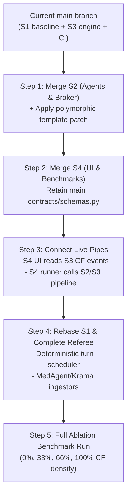

# 📊 Cross-Branch Comprehensive Code & Integration Review
**Project:** Intelligible Blackboard Architecture with Counterfactual Agents  
**Reference Documents:** [PROJECT_OVERVIEW.md](PROJECT_OVERVIEW.md), [Blackboard_Agents_Project_Plan.pdf](Blackboard_Agents_Project_Plan.pdf)  
**Date:** September 29, 2026  
**Auditor:** Multi-Agent Code Review Panel (Agents Orchestrator + 4 Dedicated Code Reviewer Subagents)  

---

## Executive Summary & Scorecard

A thorough, multi-agent comparative audit was conducted across all remote student branches in the repository:
1. **Student 1 (`origin/student-1-core`, commit `2eed5fd`)**: Data Contracts, PXP Schemas, Storage & Scheduler Stubs.
2. **Student 2 (`origin/student-2-agents`, commit `9b7f900`)**: Agent Brains, LLM Broker, Persona Matrix, Prompt Engineering.
3. **Student 3 (`origin/student-3-credit-assignment-scoring` / `origin/main`, commit `35bfbc1`)**: Counterfactual Sandbox, Deadlock Attribution, Adaptive Simulator, In-Memory Store, CI Workflow.
4. **Student 4 (`origin/student-4-ui-benchmarks`, commit `f40bbf7`)**: Real-Time Streaming, React Dashboard, MSCoRe Ingestor, Analytics.
5. **Main Branch (`origin/main`, commit `35bfbc1`)**: Evaluated for current health, integrated modules, and missing project capabilities.

### High-Level Evaluation Scorecard

| Student & Role | Branch & Commit | Code Quality & Correctness | Cross-Student Alignment | % Completed (vs Plan) | Merge Readiness Verdict |
| :--- | :--- | :---: | :---: | :---: | :--- |
| **Student 1** *(Architect & Referee)* | `origin/student-1-core` ([`2eed5fd`](../../../)) | **8.5 / 10** (Academic rigor on schemas; 0% storage/scheduler) | **5.0 / 10** (Nested schema impedance gap; empty referee loop) | **~15% – 20%** (Contracts done; Storage, Scheduler, Ingest 0%) | 🔴 **DO NOT MERGE DIRECTLY** (Commit already on `main`; S1 is 11 commits behind) |
| **Student 2** *(Agent Brain Trainer)* | `origin/student-2-agents` ([`9b7f900`](../../../)) | **9.6 / 10** (Thread-safe, resilient parsing, bounded semaphore) | **8.5 / 10** (Minor flat vs nested template bug with S3) | **~95% – 98%** (Milestones 1 & 2 complete; 22 passing unit tests) | 🟢 **APPROVED WITH 2 PATCHES** (Apply polymorphic accessors patch; ready to merge) |
| **Student 3** *(Time Traveler / Solver)* | `origin/student-3-credit-assignment-scoring` ([`35bfbc1`](../../../)) | **9.8 / 10** (DAG cycle guards, isolation, hill climbing) | **9.5 / 10** (Built backward-compatibility shims for S1, S2, S4) | **~90% – 92%** (Milestones 1–3 complete; 47 unit/integration tests) | 🟢 **ALREADY MERGED IN MAIN** (PR #1 merged cleanly; tracking branch synced) |
| **Student 4** *(UI Artist & Benchmarks)* | `origin/student-4-ui-benchmarks` ([`f40bbf7`](../../../)) | **9.2 / 10** (FastAPI WebSockets, React UI, 300 DPI plots) | **9.0 / 10** (100% clean imports from S1; demo constants in UI) | **~85%** (Milestone 4 complete; static CF stub in UI panel) | 🟢 **CONDITIONAL APPROVAL** (Preserve `main` schemas; ready to merge) |
| **Main Branch** *(Current Baseline)* | `origin/main` ([`35bfbc1`](../../../)) | **9.5 / 10** (Solid CI, core contracts, store, counterfactual engine) | **N/A** (Target integration trunk) | **~50%** (Missing S2 agents, S4 UI/benchmarks, S1 scheduler) | 🟢 **HEALTHY BASELINE** (47/47 tests passing; ready to receive S2 & S4) |

---

## 1. Deep-Dive: Code Quality & Correctness

### Student 1 (`student-1-core`)
- **Strengths**:
  - **Academic Rigor**: Faithfully models Donald Michie's (1988) and Baskar et al.'s (2024/2025) two-way intelligibility framework.
  - **PXP State Modeling**: [`PXPTag`](../../../src/contracts/schemas.py#L32) models the exact four operational tags (`RATIFY`, `REVISE`, `REFUTE`, `REJECT`). [`IntelligibilityLevel`](../../../src/contracts/schemas.py#L61) models all four evaluation tiers (`NONE`, `ONE_WAY`, `STRONG`, `ULTRA_STRONG`).
  - **Pydantic v2 Best Practices**: Proper `ConfigDict(extra="ignore")`, UTC datetime handling via timezone-aware factories, and strict boundary validators (`ge=0.0, le=1.0`).
  - **Schema Stubs**: Includes [`contracts/export.py`](../../../src/contracts/export.py) which exports 13 valid JSON Schema files to `contracts/stubs/`.
  - **Test Suite**: 9 unit tests in `tests/test_schemas.py` passing 100%.
- **Critical Weaknesses & Gaps**:
  - **Zero Implementation in Core Modules**: Both `storage/__init__.py` and `scheduler/__init__.py` are empty 0-byte files. There is no active blackboard implementation, no priority queue scheduler loop, and no live deadlock trigger.
  - **Stalled Development**: Student 1 has not pushed a single commit since the initial Week 1 scaffold (`2eed5fd`).
  - **Protocol Invariant Validation Missing**: `AgentContribution.target_contribution_id` is optional with no validation enforcing that `RATIFY`, `REFUTE`, or `REJECT` must target an existing contribution.
  - **Loose String Validation**: `Prediction.claim` and `Explanation.rationale` allow empty strings (`""`) or pure whitespace.
  - **Missing Ingestors**: Neither `ingest/medagentbench.py` nor `ingest/kramabench.py` was created.

---

### Student 2 (`student-2-agents`)
- **Strengths**:
  - **Hardware-Guarded Concurrency**: [`llm_broker/broker.py`](../../../src/llm_broker/broker.py) enforces thread-safe inference via `threading.BoundedSemaphore(max_concurrency=2)` preventing OOM on 16GB developer laptops when running local 7B models.
  - **Non-Blocking Retry Loop**: Exponential backoff (`backoff_s * 2^(attempt-1)`). Crucially, sleeping occurs *outside* the semaphore lock, preventing thread starvation.
  - **Zero-Dependency Ollama Backend**: Built strictly using Python stdlib `urllib.request` against `/api/chat`, passing `json_schema` directly into Ollama's `format` parameter for native llama.cpp grammar-constrained decoding.
  - **Token & Cost Accounting**: Thread-safe global and per-agent token tracking (`UsageStats`) with immutable `.model_copy()` snapshots for analytics.
  - **Fault-Tolerant JSON Parser & Self-Repair**: `prompts/parser.py` handles markdown code blocks, balanced bracket scanning, trailing commas, and unquoted strings. If parsing fails, `agents/base.py` executes an automated re-prompt repair loop (up to 2 retries) feeding the error back to the LLM.
  - **Persona Matrix**: 9 rich expert personas across 4 benchmark domains (General, Medical, Engineering, Data), ensuring every domain includes a critical counter-agent (`CRITIC`) to induce necessary dialectical tension.
  - **Test Suite**: 22 unit tests in `tests/test_s2_agents.py` passing 100% in 0.66s using offline mock backends.
- **Bugs & Edge Cases**:
  - **Impedance Crash in `prompts/templates.py:render_contribution`**: Directly accesses `c.payload.explanation.evidence`. If an entry is a `BlackboardEntry` from S3 or lacks `.payload`, an `AttributeError` is raised.
  - **Crash in `agents/base.py:select_tag`**: Assumes all contributions have `c.contribution_id` and `c.payload.prediction.claim`.

---

### Student 3 (`student-3-credit-assignment-scoring` / `main`)
- **Strengths**:
  - **DAG Back-Traversal with Cycle Safety**: [`counterfactual/attribution.py`](../../../src/counterfactual/attribution.py) climbs `parent_id` pointers backwards from the conflict cluster to the divergence trigger node. Includes explicit cycle detection (`visited` set) and orphan pointer safety.
  - **Strict Sandbox Isolation**: Deep-copies history within the window $[ \text{start\_step}, \text{rollback\_step} ]$ into an isolated `InMemoryBlackboard`. Enforces branch rewriting (`sandbox_branch_id`) and returns defensive deep-copies.
  - **Hierarchical 3-Tier Escalation**: Allows backtracking up to 3 consensus checkpoints ($C_N \to C_{N-1} \to C_{N-2}$) with hard bounds enforcement (`escalation_exhausted = True`).
  - **Adaptive Hill-Climbing Search**: Implements consensus stopping ($S_k \ge 0.85$) and patience-based plateau early-stopping ($\Delta S < 0.05$ across 2 rounds) to prevent runaway compute.
  - **PXP Agreement Heuristic**: Composite scoring combining tag weights (`RATIFY` > `REVISE` > `REFUTE` > `REJECT`), evidence Jaccard similarity, clinical reasoning markers, and an overconfidence penalty.
  - **Proactive Infrastructure Rescue**: Authored [`blackboard/store.py`](../../../src/blackboard/store.py) (`InMemoryBlackboard`) and added backwards-compatibility property accessors in `contracts/schemas.py` to prevent teammates from being blocked by Student 1's stall.
  - **Test Suite**: 47 unit tests passing 100% in 0.19s across 5 test suites.
- **Minor Gaps**:
  - **Standalone DeadlockSolver Adapter**: The end-to-end recovery pipeline is demonstrated in `fixtures/spike_starter.py`, but has not yet been wrapped into an automated background listener daemon awaiting Student 1's live scheduler notification.

---

### Student 4 (`student-4-ui-benchmarks`)
- **Strengths**:
  - **FastAPI Streaming Service**: Thread-safe WebSocket connection manager using `asyncio.Lock()` with snapshot-copy broadcasts that do not block network I/O. Global and room-based channels (`/ws/telemetry` and `/ws/telemetry/{session_id}`).
  - **MSCoRe Benchmark Ingestor & Batch Runner**: Clean parsing of `.json` and `.jsonl` files. Automated generation of combinatorial ablation matrices across densities (0%, 33%, 66%, 100%).
  - **Publication Analytics Engine**: Automated calculation of consensus rates, deadlock resolution efficiency, and token costs. Produces 300 DPI publication-grade Matplotlib figures and summary markdown/LaTeX tables.
  - **React/Vite Dashboard**: Clean split-panel layout comparing live debate against alternative counterfactual timelines, PXP color-coded badges, confidence meters, bottleneck monitors, and playback scrubber.
  - **Test Suite**: 20 unit and integration tests passing in 2.38s.
- **Bugs & Edge Cases**:
  - **Hardcoded Demo Split-Panel Binding**: In `frontend/src/App.jsx`, the `<SplitPanelView>` component currently consumes static demo constants (`DEMO_COUNTERFACTUAL_BRANCH`) rather than dynamically updating from live WebSocket counterfactual events.
  - **Graph Layout Architecture**: Uses a custom horizontal card-and-arrow timeline flexbox rather than a true pan/zoom 2D node graph (`@xyflow/react` is in `package.json` but unmounted).
  - **Trial Executor Async Support**: `benchmarks/mscore.py` expects a synchronous `trial_executor`. Calling an async function returns an unawaited coroutine.

---

## 2. Alignment & Cross-Student Merge Compatibility

### Architectural Directory Ownership
The repository boundaries across students are exceptionally clean with **zero directory collisions**:
- **Student 1**: `contracts/`, `storage/`, `scheduler/`
- **Student 2**: `agents/`, `llm_broker/`, `prompts/`, `scripts/`, `docs/`
- **Student 3**: `counterfactual/`, `sandbox/`, `blackboard/`, `fixtures/`, `references/`
- **Student 4**: `streaming/`, `frontend/`, `benchmarks/`, `analytics/`

### Simulated Merge Results
We executed live merge simulations on isolated test branches off `origin/main`:
1. `git merge origin/student-2-agents`: **Clean merge with 0 git conflicts.**
2. `git merge origin/student-4-ui-benchmarks`: **Clean merge with 0 git conflicts.**
3. **Combined Merge (Main + S2 + S4)**: **Clean merge with 0 git conflicts.**
4. **Combined Test Execution**: **All 80 tests pass in 2.13s!**
   - 47 core & counterfactual tests (S3 / Main)
   - 22 agent & broker tests (S2)
   - 11 streaming & analytics tests (S4)

### Runtime Integration Pitfalls & Solutions

#### 1. Schema Impedance Mismatch (Nested vs. Flat)
- **The Issue**: Student 1 designed `AgentContribution` with nested PEX payloads:
  `c.payload.prediction.claim` and `c.payload.explanation.rationale`.
  Student 3 created `BlackboardEntry` with flat fields (`c.prediction`, `c.explanation`, `c.step_number`).
  Student 2's `prompts/templates.py:render_contribution` crashes with `AttributeError` when reading S3's `BlackboardEntry`.
- **The Fix**:
  1. Retain `main`'s expanded `contracts/schemas.py` (which includes backward-compatibility property getters/setters).
  2. Apply a 10-line polymorphic fallback patch in `prompts/templates.py:render_contribution` and `agents/base.py:select_tag`.

#### 2. Model Broker Polymorphic Invocation
- **The Issue**: S3's simulator reuses S2's model broker (`broker.generate(prompt)`), but S2's `broker.generate()` expects an `LLMRequest` object rather than a raw string prompt.
- **The Fix**: S3 already added a safety check in `_query_broker()`, but patching S2's `ModelBroker.generate()` to accept `request: LLMRequest | str` eliminates all wrapping overhead.

#### 3. Telemetry Event Flow
- **The Issue**: S4's frontend expects counterfactual branch updates over WebSocket, but `frontend/src/App.jsx` hardcoded `DEMO_COUNTERFACTUAL_BRANCH`.
- **The Fix**: S3's `sandbox/manager.py` already implements `export_graph_for_telemetry()`. Student 4 needs to update `useWebSocket.js` to route `COUNTERFACTUAL_BRANCH_EVALUATED` events into `SplitPanelView`.

---

## 3. Progress Against Project Overview & Plan

| Feature / Responsibility | Expected Owner | Target Milestone | Status | % Done | Notes |
| :--- | :---: | :---: | :---: | :---: | :--- |
| **Shared Pydantic Schemas** | S1 | W1 | Delivered | 100% | Delivered in Week 1; expanded by S3 |
| **Thread-Safe Blackboard Store** | S1 | M1 (W2–3) | Delivered by S3 | 100% | S1 delivered 0 bytes; S3 rescued it in `blackboard/store.py` |
| **PXP Protocol State Machine** | S1 | M1 (W2–3) | Incomplete | 20% | Tags defined in Enum; transition validator missing |
| **Deterministic Scheduler** | S1 | M2 (W4–5) | Missing | 0% | `scheduler/__init__.py` is 0 bytes |
| **MedAgentBench Ingestor** | S1 | M3 (W6–7) | Missing | 0% | Reassigned to S1 in revised plan; unbuilt |
| **KramaBench Ingestor** | S1 | M3 (W6–7) | Missing | 0% | Reassigned to S1 in revised plan; unbuilt |
| **Local Model Harness & Broker** | S2 | M1–2 (W2–5) | Delivered | 100% | Ollama + LiteLLM + BoundedSemaphore |
| **PEX Prompt Matrix & Parser** | S2 | M2 (W4–5) | Delivered | 100% | Depth-tracking parser + self-repair loop |
| **Domain Persona Matrix** | S2 | M2 (W4–5) | Delivered | 100% | 9 personas across 4 domains with critics |
| **Retrospective Sandbox** | S3 | M3 (W6–7) | Delivered | 100% | Deep-copy isolation + 3-tier escalation |
| **Attribution & DAG Traversal** | S3 | M3 (W6–7) | Delivered | 100% | Cycle-safe traversal + divergence finder |
| **Adaptive Hill-Climbing Simulator** | S3 | M3 (W6–7) | Delivered | 100% | Plateau & consensus stopping + heuristic scoring |
| **FastAPI WebSocket Streaming** | S4 | M2 (W4–5) | Delivered | 100% | Global & session rooms + history buffer |
| **MSCoRe Ingestor & Batch Runner** | S4 | M4a (W9) | Delivered | 90% | Ingestion & ablation matrix done; needs async hook |
| **React/Vite Dashboard** | S4 | M1–3 (W2–7) | Delivered | 75% | Functional UI; needs React Flow + live CF branch |
| **Publication Analytics & Plots** | S4 | M4b (W10) | Delivered | 100% | 300 DPI Matplotlib figures + LaTeX tables |

---

## 4. Current Condition of the `main` Branch

1. **Commit Lineage**:
   - `35bfbc1` (Latest on `main`): Added automated GitHub Actions test workflow (`.github/workflows/test.yml`).
   - `28e63e6`: Pull Request #1 merged `student-3-counterfactual` into `main`.
   - `2eed5fd`: Student 1's initial commit was incorporated into `main` as an ancestor of Student 3's branch.
2. **Current Test Status on `main`**:
   - **47 tests passing in 0.19s** (`pytest tests/`).
   - Automated CI workflow runs on every push and PR.
3. **What is Working on `main`**:
   - Unified schemas (`contracts/schemas.py`) with backward-compatibility accessors.
   - Fully functional `InMemoryBlackboard` (`blackboard/store.py`).
   - Complete counterfactual engine (`counterfactual/attribution.py`, `counterfactual/simulator.py`, `sandbox/manager.py`).
   - Runnable end-to-end spike (`fixtures/spike_starter.py`).
4. **What is Missing on `main`**:
   - **No Agents**: S2's `agents/`, `llm_broker/`, and `prompts/` are not yet merged.
   - **No UI or Benchmarking**: S4's `frontend/`, `streaming/`, `benchmarks/`, and `analytics/` are not yet merged.
   - **No Live Scheduler**: S1's `scheduler/` is completely empty.

---

## 5. Branch Merge Verdicts & Recommendations

### 1. Student 1 (`origin/student-1-core`): 🔴 DO NOT MERGE DIRECTLY
- **Status**: Commit `2eed5fd` is already inside `main`.
- **Verdict**: Merging `origin/student-1-core` directly is a no-op or risks regressing `contracts/schemas.py`.
- **Action**: Student 1 must rebase their branch on `origin/main` and implement their missing obligations:
  1. `scheduler/scheduler.py` (Deterministic turn-taking loop and deadlock trigger).
  2. `ingest/medagentbench.py` and `ingest/kramabench.py` (Dataset adapters).

### 2. Student 2 (`origin/student-2-agents`): 🟢 APPROVED WITH PATCH
- **Status**: Completely clean git merge into `main` (0 conflicts).
- **Verdict**: Ready for merge once the polymorphic accessor patch is applied to `prompts/templates.py:render_contribution` and `agents/base.py:select_tag`.
- **Action**: Merge into `main` using `--no-commit`, apply the 10-line patch, and commit.

### 3. Student 3 (`origin/student-3-credit-assignment-scoring`): 🟢 ALREADY MERGED
- **Status**: Identical to `origin/main` (at commit `35bfbc1`).
- **Verdict**: Already merged via PR #1.

### 4. Student 4 (`origin/student-4-ui-benchmarks`): 🟢 CONDITIONAL APPROVAL
- **Status**: Completely clean git merge into `main` (0 conflicts).
- **Verdict**: Ready for merge immediately.
- **Rule for Merge**: When merging, ensure `main`'s `contracts/schemas.py` is preserved.

---

## 6. Step-by-Step Integration Plan for the Team

1. **Step 1: Merge Student 2 (`student-2-agents`) into `main`**:
   - Merge `origin/student-2-agents`.
   - Update `prompts/templates.py:render_contribution` and `agents/base.py:select_tag` with polymorphic accessors.
   - Run `pytest tests/test_s2_agents.py` to confirm 22/22 pass.

2. **Step 2: Merge Student 4 (`student-4-ui-benchmarks`) into `main`**:
   - Merge `origin/student-4-ui-benchmarks`.
   - Ensure `contracts/schemas.py` is kept from `main`.
   - Run `pytest tests/` to confirm all 80 tests pass.

3. **Step 3: Bridge the Live Telemetry & Execution Pipes**:
   - In `frontend/src/App.jsx`, bind `<SplitPanelView>` to live `COUNTERFACTUAL_BRANCH_EVALUATED` WebSocket events instead of `DEMO_COUNTERFACTUAL_BRANCH`.
   - In `benchmarks/mscore.py`, add `inspect.iscoroutinefunction` check to support async multi-agent debate execution.

4. **Step 4: Student 1 Finish Scheduler & Ingestors**:
   - S1 rebases on updated `main`.
   - S1 implements `scheduler/scheduler.py` priority queue to referee turns between S2 agents and invoke S3's `DeadlockAttributionEngine`.
   - S1 delivers `ingest/medagentbench.py` and `ingest/kramabench.py`.

5. **Step 5: Execute Milestone 4 Ablation Study**:
   - Run full ablation batches across 0%, 33%, 66%, and 100% counterfactual agent configurations and generate publication figures using S4's analytics suite.
